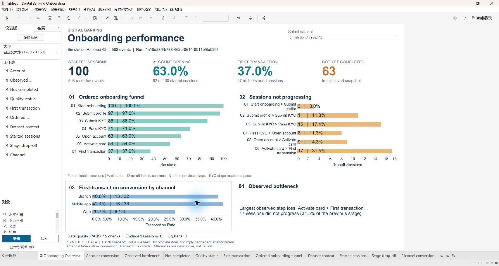
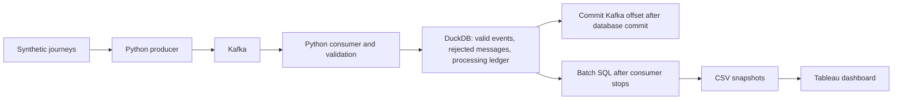

# Real-time Digital Banking Analytics

A local data engineering project that simulates digital banking onboarding events,
ingests them through Kafka into DuckDB, and reports onboarding conversion with SQL.
The business question is: **where do customer journeys stop between starting an
application and completing a first transaction?**

All customer and transaction data is synthetic. This is a personal MVP; it has no
real bank integration or production deployment.

## Verified MVP and demo

**Kafka-based event ingestion with validated persistence and batch SQL analytics.**
On 2026-11-10, 83 automated tests passed in both the existing environment and a
fresh Python environment. Live Kafka crash/replay tests passed, and four dashboard
views were checked in Tableau Desktop. See the [P0.6 verification report](docs/p06_final_verification.md)
for commands, counts, evidence and untested boundaries, and the
[presentation notes](docs/project_presentation.md) for technical decisions and CV bullets.



### Quick start: new data, Kafka to Tableau

Prerequisites: Python 3.11, Docker Desktop with its engine running, port 9092 free,
and an installed/activated Tableau Desktop for the final visual step. Run these
PowerShell commands from the repository root. Stop if any command fails.
The complete source tree must be present; see the report's Git release checklist.

```powershell
py -3.11 -m venv .venv
.\.venv\Scripts\python.exe -m pip install -r requirements.txt
.\.venv\Scripts\python.exe -m pip check
docker compose up -d
docker compose exec -T kafka /opt/kafka/bin/kafka-topics.sh --bootstrap-server localhost:9092 --list
```

Wait until the last command succeeds before continuing; a running container is
not necessarily a ready broker. If this project already has a stopped container,
`docker compose start kafka` preserves that container. Do not run `down -v` or
delete old topics/databases as part of this demo.

Use a new topic, group, database and output directory on every demonstration:

```powershell
$suffix = [guid]::NewGuid().ToString('N').Substring(0,12)
$demo = "artifacts/demo-$suffix"
$runId = [guid]::NewGuid().ToString()
New-Item -ItemType Directory -Path $demo | Out-Null
$env:BANKING_KAFKA_BOOTSTRAP_SERVERS = 'localhost:9092'
$env:BANKING_KAFKA_TOPIC = "banking-demo-$suffix"
$env:BANKING_KAFKA_GROUP_ID = "banking-demo-$suffix-consumer"
$env:BANKING_DB_PATH = "$demo/events.duckdb"
docker compose exec -T kafka /opt/kafka/bin/kafka-topics.sh --bootstrap-server localhost:9092 --create --topic $env:BANKING_KAFKA_TOPIC --partitions 1 --replication-factor 1
.\.venv\Scripts\python.exe -B -m producer.producer --run-id $runId --seed 42 --base-time 2026-11-08T00:00:00Z --customer-count 5 --output-dir "$demo/batches"
```

With the pinned environment this fixture produces **20 acknowledged events**.
Check the producer summary before continuing. For a different seed/customer
count, replace `20` below with the actual acknowledged count.

```powershell
.\.venv\Scripts\python.exe -B -m consumer.consumer --max-messages 20 --idle-timeout 60
.\.venv\Scripts\python.exe -B run_analytics.py --db-path "$demo/events.duckdb" --strict --export-dir "$demo/analytics"
.\.venv\Scripts\python.exe -B scripts/build_tableau.py --snapshot "$demo/analytics" --output-dir "$demo/tableau"
```

Consumer: received/inserted/committed = 20, rejected/duplicate = 0. After it exits,
analytics should report 5 started sessions, ordered funnel **5, 4, 4, 2, 2, 2, 1**,
account opening **40%**, first transaction **20%**, and 15 passing quality checks.
Open `Digital Banking Onboarding.twbx` inside the new `$demo/tableau` directory
in Tableau. It includes the CSV data and does not require a live database connection.
This fresh demo has one dataset; the retained `tableau/validated/` package has
Historical Baseline, Simulation A and Simulation B. Do not overwrite that package.

This sequence was tested in a separate source directory and fresh virtual
environment, using the existing local broker and activated Tableau. A new OS,
first-time Docker installation/image download and remote Git clone were not tested.

### Technology stack

| Component | Implementation |
|---|---|
| Simulation, validation, ingestion and tests | Python 3.11; standard-library unittest |
| Event transport | Apache Kafka 4.3.1 in Docker Compose; confluent-kafka client |
| Persistence and SQL | DuckDB; pinned packages in requirements.txt |
| Presentation | CSV snapshots and Tableau Desktop 2026.1 |



## Architecture and current scope

```text
Synthetic journeys -> Python producer -> Kafka -> validation + consumer
                                                     |
                                                     v
                                            DuckDB transaction
                                      +-----------------------------+
                                      | raw_events OR rejected_events|
                                      | + processed_messages         |
                                      +-----------------------------+
                                                     |
                                      Commit Kafka progress after DB commit

After ingestion stops: raw_events -> temporary SQL models -> console + CSV snapshots

CSV snapshots -> packaged Tableau workbook (three datasets verified in Desktop)
```

The MVP uses **batch ingestion followed by analytics**: finish consuming a batch,
stop the consumer so it releases the database, then run the read-only reports.
Separate processes should not try to read the DuckDB file while the consumer has
it open for writing. The Tableau workbook uses exported snapshots.

| Capability | Current state |
|---|---|
| Seven-stage synthetic journeys with weighted dropout | Implemented |
| Kafka producer and DuckDB consumer | Implemented; isolated live verification script included |
| Data overview, event counts, onboarding funnel | Implemented; saved baseline rechecked on 2026-11-06 |
| Shared settings, explicit entry points, pinned dependencies | P0.1 foundation |
| Validation, rejected-event storage, event-ID uniqueness, commit-after-persistence | Implemented in P0.2; see verification evidence |
| Run IDs, controlled random seeds/base times, saved-file replay | Implemented in P0.3; isolated live verification recorded |
| Run-scoped ordered funnel, data quality, KPI/channel/session CSV exports | Implemented in P0.4; read-only source and export reconciliation verified |
| Tableau dashboard | P0.5 complete locally; all three datasets, displayed values and parameter interaction verified in Tableau Desktop 2026.1 |

P0.2 implements **at-least-once consumption with idempotent persistence**. The
consumer commits Kafka progress only after a database transaction succeeds. A
crash in between can redeliver the message; event IDs and a source-position ledger
prevent another insertion. Invalid messages are preserved with rejection reasons
before progress advances. The producer counts broker delivery acknowledgements.

This is not an atomic transaction spanning Kafka and DuckDB. It assumes retained
Kafka records, a healthy persistent database, stable event IDs, and the correct
topic/group/database pairing. A single local broker provides no replica redundancy.

See [PROJECT_STATUS.md](PROJECT_STATUS.md) for verification evidence and scope.

## Repository map

| File | Responsibility |
|---|---|
| `config.py` | Shared defaults, environment overrides, effective-settings display |
| `producer/event_generator.py` | Validated simulation inputs, stable IDs and seeded journey generation |
| `producer/batch.py` | Prepare immutable JSONL/manifest files and validate saved batches before replay |
| `producer/producer.py` | Prepare/publish a batch or replay its saved messages |
| `consumer/consumer.py` | Consume sequentially, report outcomes, commit Kafka progress after persistence |
| `consumer/validation.py` | Validate event structure, fields and stage-specific properties |
| `consumer/storage.py` | Transactional insertion, deduplication, quarantine and legacy-schema protection |
| `compose.yaml` | One local Kafka broker, image `apache/kafka:4.3.1` |
| `run_analytics.py` | Read-only source adaptation, run selection, temporary models and CSV/manifest export |
| `sql/models/00_analytics_models.sql` | Normalized events, session eligibility and earliest ordered stage chain |
| `sql/01_data_quality_checks.sql` | Fifteen checks for missing/invalid fields, duplicates, identity conflicts and event order |
| `sql/02_event_counts_by_type.sql` | Observed raw event volumes, including excluded records |
| `sql/03_onboarding_funnel.sql` | Ordered, passed-KYC funnel and conversion/drop-off rates |
| `sql/04_onboarding_kpis.sql` | Per-run KPI counts, conversions and simulated completion durations |
| `sql/05_channel_performance.sql` | Channel conversions using the same cohort as the funnel |
| `sql/06_session_journeys.sql` | Per-session stage times, progress and exclusion reasons |
| `sql/07_ingestion_health.sql` | Explicitly database-wide ingestion counts; unavailable historical metrics are NULL |
| `tests/test_analytics.py`, `scripts/verify_analytics.py` | Edge-case metric tests and source/query/CSV reconciliation |
| `docs/analytics_contract.md`, `docs/p04_review.md` | Metric definitions, export instructions and a review guide |
| `scripts/build_tableau.py` | Validate P0.4 snapshots and build portable CSV-backed Tableau workbooks |
| `tableau/workbook.py`, `tableau/review_sources.json` | Dashboard layout, shared batch parameter and local source selection |
| `tableau/validated/`, `docs/tableau_dashboard.md` | Desktop-verified workbook, bundled data, screenshots and acceptance record |
| `tests/test_tableau.py` | BI grain/rate reconciliation, input integrity and workbook packaging checks |
| `tests/test_runtime.py` | Configuration, entry-point, persistence-refactor and read-only regressions |
| `tests/test_validation.py`, `test_storage.py`, `test_consumer.py`, `test_producer.py` | P0.2 validation, persistence, commit ordering and delivery failures |
| `scripts/verify_ingestion.py` | Isolated live Kafka verification, including a forced process exit |
| `scripts/verify_simulation.py` | Live verification of deterministic generation, file replay and independent batches |
| `tests/test_simulation.py` | Reproducibility, batch integrity, replay and backward-compatibility checks |
| `examples/p03/` | Versioned five-customer replay fixture, 20 events |
| `docs/ingestion_reliability.md` | Event contract, failure handling and recovery explanation |
| `docs/reproducible_batches.md` | Batch identity, simulation inputs, prepare/replay commands and query examples |
| `testduck.py` | Historical debug-database inspection; not an automated test |

## Python setup

The verified baseline targets **Python 3.11 on Windows**, with Docker Desktop for
Kafka. Commands below use PowerShell from the repository root. Activation is not
required because commands explicitly select the environment's Python executable.

For a fresh checkout, create an environment:

```powershell
py -3.11 -m venv .venv
```

For either a new or an existing project environment, install the declared versions:

```powershell
.\.venv\Scripts\python.exe -m pip install -r requirements.txt
.\.venv\Scripts\python.exe -m pip check
```

Runtime versions are `confluent-kafka==2.15.1`, `duckdb==1.5.5`, and
`pytz==2026.6`. The last dependency supports DuckDB's conversion of `TIMESTAMPTZ`
results into Python objects. Tests use Python's built-in `unittest`.

## Configuration

All three entry points load the same settings from `config.py`. Overrides are
ordinary environment variables; `.env` files are not automatically loaded.

| Environment variable | Default | Meaning |
|---|---|---|
| `BANKING_KAFKA_BOOTSTRAP_SERVERS` | `localhost:9092` | Kafka bootstrap address(es) |
| `BANKING_KAFKA_TOPIC` | `banking-events-analytics` | Producer and consumer topic |
| `BANKING_KAFKA_GROUP_ID` | `banking-analytics-group-v2` | Consumer group |
| `BANKING_DB_PATH` | `<repository>/banking_events_analytics.duckdb` | Consumer and analytics database |
| `BANKING_CUSTOMER_COUNT` | `100` | Positive number of customer journeys per producer invocation |
| `BANKING_DELIVERY_TIMEOUT_SECONDS` | `30` | Producer message delivery timeout; final flush allows one extra second |
| `BANKING_QUEUE_TIMEOUT_SECONDS` | `10` | Maximum wait to enqueue one message when the producer queue is full |
| `BANKING_KAFKA_TIMEOUT_SECONDS` | `10` | Kafka client socket timeout |

Relative database paths are resolved against the **repository root**, regardless
of the working directory. Absolute paths are also supported. The containing
directory must already exist. Blank settings and non-positive/non-integer counts
or timeouts fail before a client or database is opened.

The default database remains the historical analytics baseline. **The P0.2
consumer refuses to write to its legacy schema.** Use a new database path for
ingestion; there is no automatic schema migration. The analytics runner can still
read both legacy and P0.2 `raw_events` tables.

The consumer's offset-reset policy remains `earliest`. It applies when the group
has no usable committed offset; it does not replay the whole topic on every restart.

Inspect settings without opening Kafka or a database:

```powershell
.\.venv\Scripts\python.exe config.py
```

PowerShell environment settings apply only to that terminal and its child
processes. Set the same overrides in every terminal participating in a batch.

Simulation inputs are producer command-line options, separate from the connection
settings above. `--run-id` is a batch UUID (default: new UUID), `--seed` defaults
to 42, `--base-time` defaults to the current UTC time, and `--customer-count`
overrides `BANKING_CUSTOMER_COUNT`. The resolved values are saved in the manifest.
`--output-dir` defaults to `artifacts/runs`; relative artifact paths also start at
the project root. Use `--prepare-only` without Kafka, and `--replay <batch-directory>`
to resend saved events with their original IDs and timestamps.

## Read the existing local baseline

If the saved analytics database is present and the consumer is stopped:

```powershell
.\.venv\Scripts\python.exe -B run_analytics.py
```

Kafka does not need to be running for this command. It opens the configured
database **read-only** and never creates a missing database. It prints the database
path before the reports. On a fresh checkout, local database files are absent;
use the separate demo workflow below to create your own dataset.

The saved baseline was rechecked on **2026-11-06**:

| Metric | Value |
|---|---:|
| Events / distinct event IDs | 505 / 505 |
| Sessions / customers | 100 / 100 |

| Stage | Sessions | Conversion from start | Drop-off from previous |
|---|---:|---:|---:|
| onboarding_started | 100 | 100.0% | NULL |
| profile_submitted | 89 | 89.0% | 11.0% |
| kyc_submitted | 84 | 84.0% | 5.6% |
| kyc_verification_completed | 72 | 72.0% | 14.3% |
| account_opened | 66 | 66.0% | 8.3% |
| card_activated | 56 | 56.0% | 15.2% |
| first_transaction_completed | 38 | 38.0% | 32.1% |

This reproduces queries over saved data, not the original random generation.

## Select a run and export analytics

The runner creates only temporary analysis relations. It never migrates or
rewrites the source database. Stop any writer first. Kafka is not required.
By default, metrics are reported **separately for each run**; old untagged events
are grouped as `legacy`. Use an explicit database to avoid an inherited environment
override selecting a different file.

```powershell
.\.venv\Scripts\python.exe -B run_analytics.py --db-path banking_events_analytics.duckdb --list-runs
.\.venv\Scripts\python.exe -B run_analytics.py --db-path banking_events_analytics.duckdb --legacy-only --strict --export-dir exports/legacy-review-001
```

The export directory must be new. Expected on the preserved baseline: seven CSV
files and `manifest.json`, 505 event rows, 100 started sessions, 38 first-transaction
sessions, and no data-quality errors. To select a simulation run, use the UUID
returned by `--list-runs` with `--run-id`. Unknown IDs fail instead of producing a
misleading empty report. `--legacy-only` and `--run-id` cannot be combined.

`--strict` returns exit code 2 if any error-level quality check fails; it still
prints reports and writes the requested snapshot so the problems are reviewable.
Warnings do not fail strict mode. Argument, database, SQL or filesystem failures
return exit code 1. Exit code 0 means successful execution (and, with strict mode,
no error-level quality failures).

The manifest records selection, source database/WAL checksums, executed SQL
checksums, CSV row counts, types and checksums. It is written last; an incomplete
export has no completed manifest. Existing export directories are never overwritten.
See [analytics_contract.md](docs/analytics_contract.md) for definitions and
[p04_review.md](docs/p04_review.md) for the verified local results.

## Reproduce a small batch without Kafka

This creates a separate local artifact directory containing `events.jsonl` and
`manifest.json`. It opens neither Kafka nor a database:

```powershell
.\.venv\Scripts\python.exe -B -m producer.producer --prepare-only --run-id 11111111-1111-4111-8111-111111111103 --seed 42 --base-time 2026-11-08T00:00:00Z --customer-count 5 --output-dir artifacts/reproduction
```

Expected: `Batch ready`, `event_count: 20`, and SHA-256
`4b87a6cabf5f000d5bac28a664d7ca8debe0389d5abdbc35f09f96d8cd5c17f6`.
The same batch is checked in under `examples/p03/11111111-1111-4111-8111-111111111103/`.
Repeating this command reuses identical files. Reusing that run ID with different
inputs in the same output root fails without overwriting them.

Validate the saved example without publishing:

```powershell
.\.venv\Scripts\python.exe -B -m producer.producer --replay examples/p03/11111111-1111-4111-8111-111111111103 --prepare-only
```

See [reproducible_batches.md](docs/reproducible_batches.md) for complete replay
instructions. A seed alone does not fix IDs and timestamps: reproducible
regeneration requires the same run ID, seed, base time, customer count, generator
version and compatible Python runtime. File replay preserves the original bytes.

## Run a separate demo batch

This workflow publishes messages and writes a **separate** database. Change the
topic, group and database together for each fresh demo. Reusing them does not
reset data or offsets. Pointing an old group at a new empty database can skip
historical messages because that group resumes its saved position. Use one
PowerShell terminal for these batch steps.

1. Start Docker Desktop, then start and inspect Kafka:

   ```powershell
   docker compose up -d
   docker compose ps
   docker compose exec -T kafka /opt/kafka/bin/kafka-topics.sh --bootstrap-server localhost:9092 --list
   ```

   Wait until the topic-list command succeeds before starting Python clients.
   There is currently no Compose health check or automatic topic initializer.

2. Select a unique demo configuration:

   ```powershell
   $env:BANKING_KAFKA_BOOTSTRAP_SERVERS = "localhost:9092"
   $batchSuffix = Get-Date -Format "yyyyMMdd-HHmmss"
   $env:BANKING_KAFKA_TOPIC = "banking-events-demo-$batchSuffix"
   $env:BANKING_KAFKA_GROUP_ID = "banking-analytics-demo-$batchSuffix"
   $env:BANKING_DB_PATH = "banking_events_demo_$batchSuffix.duckdb"
   $env:BANKING_CUSTOMER_COUNT = "100"
   .\.venv\Scripts\python.exe config.py
   ```

3. Create the separate topic and publish the batch:

   ```powershell
   docker compose exec -T kafka /opt/kafka/bin/kafka-topics.sh --bootstrap-server localhost:9092 --create --topic $env:BANKING_KAFKA_TOPIC --partitions 1 --replication-factor 1
   .\.venv\Scripts\python.exe -m producer.producer
   ```

   Before connecting to Kafka, the producer saves a complete batch under
   `artifacts/runs/<run_id>/` and prints its path as `Batch ready:`. Keep this path
   for retries; a fresh invocation without `--replay` starts a new simulation.
   A successful producer exits with code 0 and prints `Producer summary:` with
   `attempted = queued = acknowledged`, `failed = 0`, and `pending = 0`.
   Broker acknowledgement alone does not prove database persistence.

4. Enter that `acknowledged` count, then consume exactly that many records:

   ```powershell
   $expectedMessages = [int](Read-Host "Enter the producer acknowledged count")
   .\.venv\Scripts\python.exe -m consumer.consumer --max-messages $expectedMessages --idle-timeout 60
   if ($LASTEXITCODE -ne 0) { throw "Ingestion failed; inspect the error before running analytics." }
   docker compose exec -T kafka /opt/kafka/bin/kafka-consumer-groups.sh --bootstrap-server localhost:9092 --describe --group $env:BANKING_KAFKA_GROUP_ID
   ```

   For a fresh generated batch, expect `received = inserted = committed` and zero
   duplicates/rejections/replays. The consumer closes automatically at the count.
   Missing records cause a nonzero exit after the idle timeout. The group should
   have zero lag. `committed` counts confirmed record commits, not unique events.

5. After the consumer has closed, run analytics:

   ```powershell
   .\.venv\Scripts\python.exe -B run_analytics.py
   ```

   In an error-free fresh 100-customer batch, expect 100 sessions and between 100
   and 700 events, with a random funnel. Do not expect exactly 505 events or 38%
   conversion. With the P0.3 default seed 42 and 100 customers, the verified
   `onboarding-v1` generator produces 508 events; a different seed changes the
   sample. Run the separate verification commands below to exercise failures.

To resume an interrupted run, keep the same topic, group and database. The group
resumes its committed position; `--max-messages` counts records in the **current
invocation**, so do not reuse the original full count after partial progress.
For manual recovery, use `--idle-timeout 60` without a count, then check group lag
and database totals. An idle exit alone does not prove a batch is complete.

Both legacy script commands remain supported:

```powershell
.\.venv\Scripts\python.exe producer\producer.py
.\.venv\Scripts\python.exe consumer\consumer.py
```

These are alternatives to the module commands, not additional batch steps. Importing
the modules does not publish messages, subscribe to Kafka, or open a database.

When finished, stop Kafka while retaining the existing container:

```powershell
docker compose stop
```

The current container uses anonymous volumes. `docker compose down` removes the
container, and a later `up` does not automatically reattach its old anonymous
volumes. Named-volume configuration and recovery are future work; do not remove
volumes or database files to reset a demo.

## Event and metric definitions

Each event contains `event_id`, `customer_id`, `session_id`, `event_type`,
`event_time`, `channel`, `device_type`, and JSON `properties`. P0.3 also includes
`run_id`, `generator_version`, `simulation_seed` and `simulation_base_time`.
Each new batch represents a separate synthetic customer population, with one
onboarding session per customer. Customer, session, event and business-object
identities are deterministic within a run and distinct across new run IDs.
Legacy helper calls/events remain supported; historical customer IDs were reused
across invocations and historical session IDs used random suffixes.

The final-stage weights are `[5, 10, 10, 10, 10, 15, 40]`: these are probabilities
of **stopping at each stage**, not stage-to-stage conversion probabilities. The
expected stage reach is 100%, 95%, 85%, 75%, 65%, 55%, 40%; small samples vary.

- **Funnel stage reach:** distinct eligible `(run_id, session_id)` journeys with
  all preceding stages in nondecreasing event-time order; stage 4 requires passed KYC.
- **Conversion from start:** stage sessions / starting sessions, multiplied by 100.
- **Adjacent drop-off:** (previous-stage sessions - current-stage sessions) /
  previous-stage sessions, multiplied by 100.
- **Zero denominator:** `NULL`; the first stage has no previous-stage drop-off.

Event counts in report 02 describe what was observed. Funnel report 03 describes
valid ordered progress; they can differ. Structurally invalid or inconsistent
sessions are excluded and reported, while missing prerequisites stop progression
at the last valid stage. Repeated stages use the earliest occurrence after the
previous stage, so an early retry does not hide a later valid event. Failed KYC
does not qualify stage 4; a later pass can qualify. See the metric contract for
how retries, exclusions and zero denominators are handled.

Drop-off means not observed at the next valid stage in this snapshot, not proven
permanent abandonment. Completion times use only sessions reaching the relevant
stage; simulated fixed durations do not measure production latency. Channel
comparisons are descriptive, not causal evidence or A/B tests.

Event timestamps span a simulated 20-minute journey; consecutive customers start
one minute apart from the configured base time. Messages are sent immediately,
not paced to that simulated clock. Durations and several business properties are
fixed, so these timestamps do not establish real-world pipeline latency.

Batch metadata is retained in the existing `raw_events.payload` JSON column;
P0.3 and P0.4 require no database schema migration. The analytics runner adapts
both the original eight-column database and the newer full-payload schema.
The seven SQL reports share temporary normalized models created by the runner.
Report 07 is always database-wide: malformed rejected bytes may have no run ID,
so the runner does not pretend all rejections belong to the selected run.

## Local databases and historical files

The audit found these files; none is required to be committed to Git:

| Path | Rows on 2026-11-06 | Role |
|---|---:|---|
| `banking_events_analytics.duckdb` | 505 | Current saved analytics baseline |
| `banking_events_debug.duckdb` | 2,162 | Historical test data |
| `banking_events.duckdb` | 0 | Historical empty table |
| `consumer/banking_events.duckdb` | 0 | Historical empty table from an earlier path |

P0.1 through P0.4 leave all four intact. `testduck.py` still targets the historical debug
database; use `run_analytics.py` for the configured analytics database. Ignore rules
exclude local databases, environments, caches and editor files from new additions;
they do not delete files or untrack previously tracked editor settings.

## Checks and troubleshooting

```powershell
.\.venv\Scripts\python.exe -B -m unittest discover -s tests -v
.\.venv\Scripts\python.exe -m pip check
```

These checks use temporary/in-memory databases and mocked Kafka clients. They do
not consume the existing topic or modify historical databases.

For real Kafka delivery, quarantine, crash recovery, full replay and database-error
retry verification, start Kafka and run:

```powershell
.\.venv\Scripts\python.exe -B scripts\verify_ingestion.py
```

The script creates a unique topic, three consumer groups and two databases under
`artifacts/verification/p02-<timestamp>-<suffix>/`. It deliberately terminates a
child process between database and Kafka commits. A passing run prints `PASS` and
the location of `report.json`; failures exit nonzero and retain a failure report.
Topics and evidence are retained. No historical topic offsets or databases are
reset. Customer counts are configurable with `--customers`. Historical P0.2
reports were generated before deterministic simulation was added; current runs
use the versioned P0.3 generator with its default seed.

For deterministic regeneration, replaying saved events at new Kafka offsets, and
two distinct batches in one new database:

```powershell
.\.venv\Scripts\python.exe -B scripts\verify_simulation.py
```

This creates a unique topic/group and database under
`artifacts/verification/p03-<timestamp>-<suffix>/`. It verifies batch A (508
events), replay of A (508 duplicates), and batch B (481 new events), ending with
989 unique events and 200 distinct customers/sessions. Expected output is `PASS`
and the JSON report path. All evidence is retained; old files are not migrated.

For offline SQL/export verification on a new database built from the saved sample:

```powershell
.\.venv\Scripts\python.exe -B scripts/verify_analytics.py
```

Add `--db-path <existing-database>` (repeatable) to reconcile other read-only sources
and export both all-run and individual-run snapshots. The script checks monotonic
funnels, KPI/channel agreement, CSV values/row counts/checksums and unchanged
source files. Its new artifacts are saved under `artifacts/verification/p04-.../`.

| Symptom | Check |
|---|---|
| Missing Python module | Install `requirements.txt` with the same Python executable used to run scripts |
| Database not found / unexpected results | Run `config.py`; inspect `BANKING_DB_PATH` in that terminal |
| Database is locked | Stop the consumer and other writers before opening analytics |
| Legacy or unknown schema | Use a new database, topic and group for a fresh P0.2 batch; do not delete the historical file |
| Same Kafka position has different bytes | Stop and investigate topic recreation; source-position IDs must stay stable |
| Connection refused | Start Docker Desktop and inspect the Compose service |
| Unknown topic | List topics and create the configured topic explicitly |
| No new rows after changing databases | Check the consumer group position; an existing group does not automatically replay |
| Existing run ID has different inputs | Keep the original files; choose a new run ID for a new simulation |
| Checksum mismatch or incomplete manifest | Do not publish the file; compare it with the saved original or regenerate into a separate output root |
| Analytics run ID not found | Use `--list-runs` against the explicitly selected database |
| Strict analytics exits 2 | Inspect quality checks and session exclusions; the snapshot contains failure evidence |
| Export directory exists | Choose a new directory name; do not overwrite an earlier snapshot |

## Tableau dashboard

The [verified workbook](tableau/validated/Digital%20Banking%20Onboarding.twbx) contains
the preserved 505-event baseline and both P0.3 simulations. Select one dataset to
view its KPI cards, ordered funnel, stage drop-off, channel conversion and quality
summary. Three independent CSV sources retain their respective run, run/stage and
run/channel grains. A shared parameter selects the same batch on every worksheet;
there is no physical join that multiplies counts.

The packaged workbook includes its local CSV files, so Kafka and DuckDB are not
needed when opening it. On 2026-11-09, the workbook was opened in Tableau Desktop
2026.1 and all three parameter selections were checked against P0.4. KPI cards,
ordered stages, drop-off labels, channel ratios and batch-specific explanations
matched. [Native screenshots](tableau/validated/screenshots/) and the
[verification record](tableau/validated/verification.json) accompany the package.
The full regression suite passed 83 tests. This is a local snapshot dashboard;
it has not been published to Tableau Public, Server or Cloud.

The earlier `tableau/review/` candidate is retained for history. It contains
invalid XML format attributes and should not be used. The corrected generator
uses Tableau's native format vocabulary and provides enough space for labels.
Automated data/XML checks and native rendering remain separate verification steps.

Rebuild from the retained P0.4 snapshots into a new directory:

```powershell
.\.venv\Scripts\python.exe -B scripts/build_tableau.py
```

Use repeatable `--snapshot <P0.4-export-directory>` arguments for other datasets.
On a fresh checkout, use `scripts/verify_analytics.py` to create the saved-sample
snapshot first. The default source-list paths refer to local verification evidence.
See [the Tableau guide](docs/tableau_dashboard.md) for field definitions, expected
numbers, commands and the completed desktop acceptance checks.

## Next milestones

P0.6 local verification and presentation are complete; see the
[final report](docs/p06_final_verification.md). Before a public release, review and
commit the complete working tree, then verify a fresh clone. Optional P1 work is
broker readiness automation and durable broker-storage/recovery documentation.

DuckDB is retained for the MVP. PostgreSQL is deferred until concurrent live
reporting, multiple writers or shared access becomes a concrete requirement.
